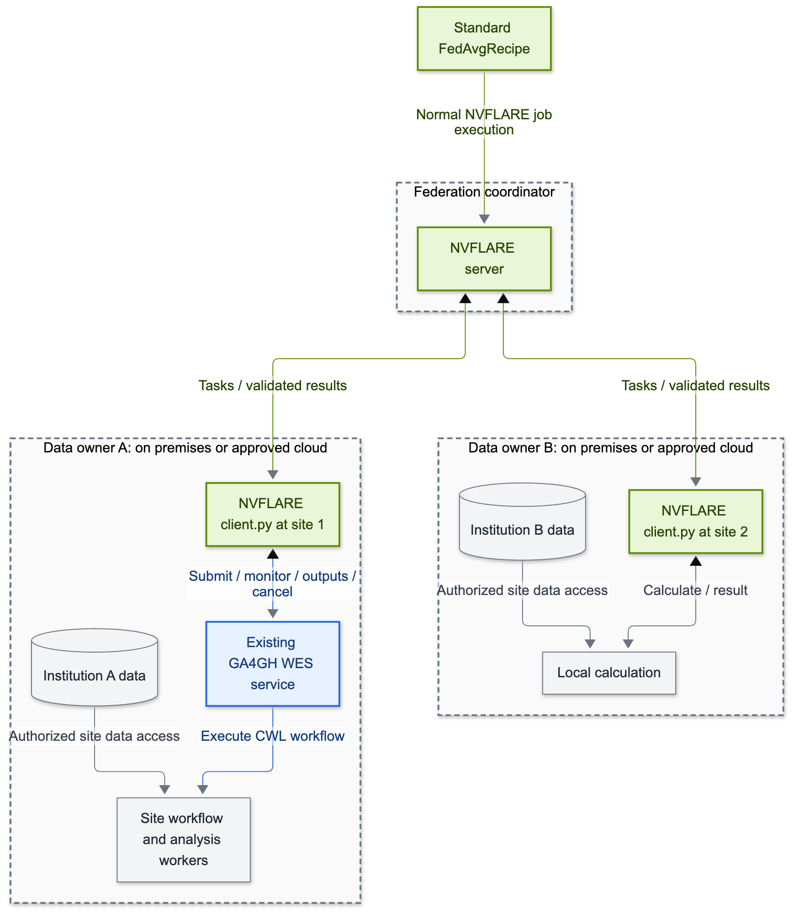

# Call institutional workflows from an NVFLARE recipe

Research institutions often already have pipelines for processing their own data. We want to reuse those pipelines in a federated analysis while NVFLARE coordinates the participating sites and combines their results.

This prototype uses **NVFLARE 2.9.0**, a standard **`FedAvgRecipe`**, and an ordinary **Client API script**. At one site, `client.py` submits its calculation to an existing **GA4GH Workflow Execution Service (WES)**, waits for completion, validates the output, and sends the result back to NVFLARE. Another site can calculate locally. WES adoption is optional for every participant.

A motivating example is a federated GWAS: each site runs its own analysis pipeline and returns approved summary statistics for aggregation. We start with a small synthetic array so the integration can be understood and checked without genomics tools or sensitive data. [FedGX](fedgx-notes.md) is a candidate for a later scientific demonstration.

## How the pieces fit together



[SVG](diagrams/overview.svg) · [Editable source](diagrams/overview.mmd)

**Green = NVFLARE; blue = GA4GH; gray = data and analysis code.** Dashed boxes represent operational ownership. An institution can operate its WES engine and workers on premises or through an approved cloud provider. WES is an API standard, not a service hosted by GA4GH. The data stores show the intended GWAS deployment; this demonstration uses only synthetic arrays.

| Component | What it does here |
|---|---|
| `FedAvgRecipe` and NVFLARE server | Start the federated job, coordinate rounds, and aggregate site results |
| Each site's `client.py` | Receive a task, run the local calculation or call WES, validate the result, and send it back |
| Institution's existing WES service | Execute a site workflow in its supported format; this example supplies CWL |
| Optional TES service | Execute individual tasks, either behind an institution's WES engine or directly from the optional TES client example |

The main path is **NVFLARE → client.py → existing WES**. It needs no new WES server, adapter database, or adapter admin identity. The separate [inbound WES adapter](inbound-wes.md) remains available for platforms that want to submit the *entire federation* through WES; it is outside this quickstart.

## Try it locally

### 1. Install the example

Use Python 3.10 or newer and a POSIX environment. From this directory:

```bash
python3 -m venv .venv
source .venv/bin/activate
python -m pip install -e .
python -c 'import nvflare; print(nvflare.__version__)'
```

The package installs released **`nvflare==2.9.0`**. Run commands from this integration directory so Python imports the installed release instead of the repository's development sources. No particular Git commit is needed.

### 2. Establish a local baseline

```bash
export DEMO_DIR="$(mktemp -d /tmp/ga4gh-recipe.XXXXXX)"
GA4GH_ANALYSIS_MODE=local python examples/job.py --workspace "$DEMO_DIR/local"
```

This runs two simulator clients and three rounds through `FedAvgRecipe(framework=FrameworkType.NUMPY, ...)`. Each site adds one to a 3 × 3 array. Expected final model:

```text
[[ 4.  5.  6.]
 [ 7.  8.  9.]
 [10. 11. 12.]]
```

### 3. Connect one site to WES

Use a service that supports **CWL v1.2**, workflow attachments, and Python 3 on its execution workers. The supplied [site workflow](examples/site-workflow.cwl) calls the same Python calculation as local mode. It intentionally has no container requirement; an institution can add its approved runtime image.

```bash
export GA4GH_ANALYSIS_MODE=wes
export GA4GH_REMOTE_SITE=site-1
export SITE_WES_ENDPOINT=https://institution.example/ga4gh/wes/v1
export SITE_WES_TOKEN="replace-with-site-owned-token"
export SITE_WES_STATE_DIR="$DEMO_DIR/wes-state"
export SITE_WES_WORKFLOW="$PWD/examples/site-workflow.cwl"
# Only when the service returns file:// outputs in an approved shared directory:
export SITE_WES_OUTPUT_DIR=/institution/shared/wes-outputs
python examples/job.py --workspace "$DEMO_DIR/mixed"
```

`site-1` calls WES and `site-2` calculates locally. Without `GA4GH_REMOTE_SITE`, each client uses its own configured mode. In a real federation, set endpoint, token, workflow path, and storage permissions locally at each institution before starting its client. A local-only site needs no WES configuration.

The example uploads the small synthetic input and calculation script as workflow parameters/attachments. It accepts JSON output from the WES service's HTTP origin, or `file://` output inside `SITE_WES_OUTPUT_DIR`. A remote WES filesystem is not automatically accessible to the client. Object storage and other output locations require a site-specific retrieval implementation; credentials are never forwarded to arbitrary output hosts.

**No institutional WES endpoint yet?** The [Toil validation guide](validation/client-wes.md) runs a real WES engine locally in a disposable validation environment and exercises this exact recipe.

### 4. Validate and visualize

```bash
python -m pip install -r requirements-validation.txt
python -m ga4gh_bridge.report \
  --model "$DEMO_DIR/mixed/ga4gh-numpy/server/simulate_job/models/server.npy" \
  --rounds 3 --out "$DEMO_DIR/report"
```

Open `$DEMO_DIR/report/index.html` for the expected and observed arrays and numerical checks. A missing, malformed, nonfinite, or incorrect result makes the validator fail. The [automated Toil run](validation/client-wes.md) also compares local and WES execution in every round and tests cancellation and recorded-run reuse.

**Validated on the H100 host with NVFLARE 2.9.0 and real Toil WES:** identical local/WES results, 33 end-to-end checks, and 108 example tests passed. See the saved [visual report](results/h100-20261026/index.html) and [validation details](validation.md#recipe-and-client-side-wes-2026-10-26). This synthetic example uses CPU only.

## Where the API call goes

The recipe launches `examples/client.py`. Between `flare.receive()` and `flare.send()`, the script calls `WesRunner.run(...)` and reads the declared output. NVFLARE remains the federation engine. The WES workflow is one site's calculation and has no NVFLARE startup kit or federation connection.

See the [integration points and code walkthrough](integration-points.md) for the exact calls, source links, and diagram. To export this same recipe for an existing federation:

```bash
python examples/job.py --job-dir "$DEMO_DIR/jobs"
```

Deploy the exported job using your normal NVFLARE POC or production workflow. Install this integration at the sites running its client script. The NumPy averaging example is a transport demonstration; a GWAS pipeline needs its own aggregation and validation contract.

## Recovery and cancellation

The client records WES run IDs against NVFLARE job, site, task, and round. Reopening the runner with the same context and inputs reuses the recorded run. A changed workflow or analysis attachment cannot silently reuse a previous result. Keep the state directory across client restarts.

A lost submission response is **never blindly retried**. WES has no portable submission-idempotency guarantee here. An operator can locate the run using its recorded correlation tags, then adopt and cancel it:

```bash
python -m ga4gh_bridge.wes /site/wes-state/operation/run.json --run-id recovered-run-id
```

For a known run, omit `--run-id`. The helper verifies the endpoint and correlation tags before adoption. Unresolved submissions and unconfirmed cancellations retain actionable records.

Queue and execution deadlines default to 300 and 600 seconds, configurable through `SITE_WES_QUEUE_TIMEOUT` and `SITE_WES_EXECUTION_TIMEOUT`. The in-process Client API checks abort flags during polling and requests WES cancellation. A hard process kill cannot execute cleanup; the institution must reconcile retained records. Simulator job abort is not supported by NVFLARE; the validation probe tests active Client API abort detection separately.

## Optional paths and next steps

- [Direct TES execution](tes-example.md): call TES from the same Client API script when a site exposes tasks instead of workflows.
- [Inbound WES adapter](inbound-wes.md): let an external platform submit a complete NVFLARE job using the Session API.
- [FedGX adaptation](fedgx-notes.md): replace synthetic weight addition with the supplied GWAS workflow and owner-approved acceptance criteria.
- [Passports and DUO roadmap](governance-roadmap.md): future researcher attribution, policy evaluation, and institution-controlled enforcement. This phase remains architecture guidance only.
- [Validation records](validation.md): results and retained evidence for the client-side WES example and earlier inbound WES/TES implementation.

Data owners control credentials, approved workloads, dataset access, and output release. Calling WES inside submitted Python is an integration point, not an authorization boundary. This prototype uses synthetic data; no Passport issuer or DUO policy engine is implemented.
