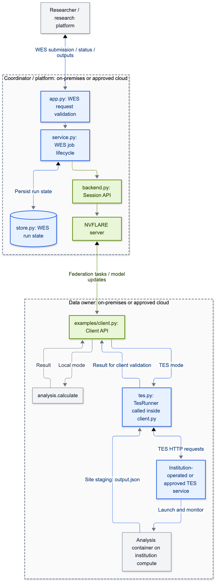

# Optional inbound adapter code walkthrough

For the primary Client API WES example, see [integration points](integration-points.md).

# GA4GH integration points: a code walkthrough

This guide explains where the example connects **NVFLARE 2.9.0** to WES and TES, and which files to change
when adapting it to another analysis. Start with the [main README](README.md) for installation and a runnable
walkthrough. All implementation files below live in this integration; the example uses the published NVFLARE
package and requires no changes to its federation engine.

There are two API boundaries. **WES manages a complete federated job through the administrative Session API.**
**TES runs a site-local calculation from inside the Client API script.** The NVFLARE client remains responsible
for receiving federation tasks and sending results back.



[View SVG](diagrams/adapter-integration-points.svg) · [Editable source](diagrams/adapter-integration-points.mmd)

**Color key:** blue = GA4GH WES/TES integration; green = NVFLARE APIs and federation;
gray = research platform and ordinary analysis code.

The dashed boxes show the proposed **operator boundaries**. WES runs under the coordinator/platform operator's
control. `client.py`, its `TesRunner` helper, site credentials, staging, and the TES execution service belong to
the data owner's approved environment. TES can be a separate service backed by an HPC cluster, Kubernetes,
or approved cloud compute; it does not need to run on the NVFLARE client's machine. `TesRunner` itself executes
inside the application script and calls that service over HTTP.

These are logical control boundaries, not a requirement to keep every process in the same building or on the
same network. An institution may use an approved third-party service. WES and TES are GA4GH-defined APIs;
GA4GH does not host the services shown here. See [where WES and TES run](inbound-wes.md#where-wes-and-tes-run) for
deployment responsibilities and staging constraints.

The validated two-site configuration selects TES for site-1 and local calculation for site-2.
That validation co-located the roles on one host; the schematic describes their intended institutional placement.

## 1. WES requests enter through FastAPI

**Read:** [app.py](ga4gh_bridge/app.py), especially `create_app()` and its `submit()` route;
[archive.py](ga4gh_bridge/archive.py), `extract_job()`.

`create_app()` mounts the WES routes under `/ga4gh/wes/v1`. Its router applies bearer-token authentication to
every WES endpoint, including output downloads. The service advertises WES **1.1.0** and the custom workflow
format **NVFLARE 1.0**; that workflow-format version is separate from the NVFLARE **2.9.0** engine version.

`POST /runs` accepts one exported job ZIP. `workflow_url` must name that attachment, and workflow and engine
parameters must be empty objects. `extract_job()` rejects traversal, links, duplicate paths, and oversized
archives, then checks for one job directory with `meta.json` and the declared application configuration
directories. This validates packaging; it does not sandbox submitted analysis code.

After validation, `WesService.create()` persists the request and returns a WES `run_id`. A background worker
performs the NVFLARE submission. Remote URL fetching and workflow parameter templating are not implemented.

## 2. Four Session methods connect WES to NVFLARE

**Read:** [backend.py](ga4gh_bridge/backend.py), `SessionBackend` and `configured_backend()`.

| WES operation | Adapter method | NVFLARE Session method |
|---|---|---|
| Submit a complete analysis | `SessionBackend.submit()` | `submit_job(job_dir, submit_token=token)` |
| Refresh its execution status | `SessionBackend.meta()` | `get_job_meta(job_id)` |
| Request cancellation | `SessionBackend.cancel()` | `abort_job(job_id)` |
| Collect its result files | `SessionBackend.download()` | `download_job_result(job_id, destination=...)` |

`configured_backend()` creates a Session with the operator's provisioned startup kit and study:

```python
new_secure_session(
    username=username,
    startup_kit_location=kit,
    study=study,
    timeout=10,
    command_timeout=30,
    auto_login_max_tries=1,
)
```

The values come from `NVFLARE_ADMIN_USER`, `NVFLARE_STARTUP_KIT`, and `NVFLARE_STUDY`. These credentials belong
to the adapter process. The WES caller does not supply them in the exported job.

`SessionBackend._call()` lazily opens the Session, checks support for retry-safe submission, classifies
permanent API rejections, and closes failed connections so a subsequent reconciliation can reconnect.
The service uses this Session from one reconciliation thread.

## 3. Persistent reconciliation makes submission and cancellation recoverable

**Read:** [service.py](ga4gh_bridge/service.py), `WesService._reconcile()`;
[store.py](ga4gh_bridge/store.py), `Store`.

SQLite retains the WES request, run/job association, submission-attempt flag, cancellation intent, lifecycle
state, and diagnostics. The persisted **WES run ID also serves as the NVFLARE submission token**. The central
submission sequence is:

```python
self.store.patch(run_id, submission_started=True)
job_id = self.backend.submit(run["job_dir"], run_id)
run = self.store.patch(run_id, job_id=job_id)
```

If NVFLARE accepts the job but the reply is lost, the next attempt uses that same token to recover the job ID.
After an adapter restart, the worker resumes nonterminal runs from SQLite. This is internal retry safety for
an accepted WES run: sending another `POST /runs` creates a new run and a new token.

Cancellation is also persisted first. If submission has never started, the run can become `CANCELED` immediately.
If a submission may already have succeeded, the worker resolves its job ID before requesting an abort. Once
NVFLARE reports a terminal outcome, that outcome determines the WES result: a job that finishes before the
abort takes effect can still become `COMPLETE`.

The state directory has an exclusive owner lock. Run one Uvicorn worker per state directory; this example is
not a distributed queue or a multi-replica service. The [WES reference](wes-reference.md) details state mappings
and operational limits.

## 4. Completion includes publishing selected results

**Read:** [service.py](ga4gh_bridge/service.py), `_publish()`, `run_log()`, and `log()`;
[config.py](ga4gh_bridge/config.py), `Settings.output_paths`.

An NVFLARE `FINISHED:COMPLETED` status triggers result collection. `_publish()` downloads the job results,
checks the configured files, rejects symlinks and paths outside the download directory, enforces the output
size limit, and atomically publishes the selected outputs. **WES becomes `COMPLETE` only after publication.**
Missing or invalid outputs are retried up to the configured limit before the run becomes `SYSTEM_ERROR`.

The default selected file is `workspace/models/server.npy`. Set `WES_OUTPUT_PATHS` for another job's outputs.
The run response exposes authenticated output URLs and sanitized diagnostics. WES task inspection represents
the entire job as one task named `federation`; individual site/round TES tasks are tracked separately.

## 5. The Client API chooses local or TES execution

**Read:** [examples/client.py](examples/client.py), `main()` and `check_cancel()`;
[examples/job.py](examples/job.py), `make_recipe()`.

The client follows the usual `flare.init()` → `flare.receive()` → calculation → `flare.send()` flow. The
integration is the choice of calculation between receive and send. This excerpt shows that choice; `document`
contains the received weights, and `context` identifies the current job, site, task, and round:

```python
if mode == "tes":
    if runner is None:
        runner = TesRunner(TesSettings.from_env())
    result = runner.run(document, context, check_cancel=check_cancel)
elif mode == "local":
    result = calculate(document)
```

`GA4GH_ANALYSIS_MODE` chooses the mode. In a shared POC environment, `GA4GH_TES_SITE=site-1` limits TES to
that site. Both paths return the same JSON structure, `{"weights": [...]}`. The client converts the result
to the received model's dtype, checks shape and finite values, and sends an `FLModel` containing the updated
parameters and `weight_mean` metric. NVFLARE handles aggregation.

`make_recipe()` exports a two-client, three-round `FedAvgRecipe` with `framework=FrameworkType.NUMPY` using this script. Its
`launch_external_process=False` setting is deliberate: `check_cancel()` uses the in-process Client API's
abort/stop detection during TES polling. A different executor arrangement needs its own abort-handling check.

## 6. TesRunner translates one site calculation into a TES task

**Read:** [tes.py](ga4gh_bridge/tes.py), `TesRunner.run()`, `_run()`, `_recover()`, and `cancel_record()`;
[analysis.py](ga4gh_bridge/analysis.py), `calculate()` and `run_file()`.

`TesRunner` hashes the `{job_id, site, task, round}` context to identify an operation. It stages `input.json`
and `analysis.py` in a site-controlled directory and submits a task that runs:

```text
python /work/analysis.py /work/input.json /work/output.json
```

The TES request declares `file://` input/output locations, a container image, resources, and correlation tags.
The institution's TES service stages those files and launches the container. `analysis.py` uses only the
Python standard library and needs no NVFLARE installation or federation credentials. Local mode calls the
same `calculate()` function directly. This spike assumes a shared staging directory accessible to the client
and TES service at the same absolute path.

| TES interaction | Implementation behavior |
|---|---|
| `POST /tasks` | Persist `task.json` before sending; save the returned TES task ID |
| `GET /tasks/{id}?view=MINIMAL` | Poll with bounded requests, queue/execution deadlines, and abort checks |
| `GET /tasks` filtered by operation tag | Resolve an ambiguous submission without blindly posting again |
| `POST /tasks/{id}:cancel` | Request cancellation and poll for a terminal outcome |
| Read staged `output.json` | Require a successful task and a regular, size-bounded output file; the Client API script validates its values |

The retained `task.json` joins the NVFLARE job/site/round to the TES task ID. An uncertain submission remains
`SUBMISSION_UNKNOWN` until reconciliation; an unconfirmed cancellation remains `CANCEL_UNCONFIRMED` for operator
cleanup. A hard process kill cannot run Python cleanup. The [TES guide](tes-example.md) describes reconciling a
retained record with `python -m ga4gh_bridge.tes`.

## 7. Validation checks both API behavior and numerical results

| Code | What it verifies or produces |
|---|---|
| [tests/poc_smoke.py](tests/poc_smoke.py), `run()` | Real two-client POC; direct/WES/mixed results; token reuse; WES restart; cancellation |
| [validation/funnel_run.py](validation/funnel_run.py), `main()` | Real Funnel/Docker TES execution and checks for remaining task containers |
| [ga4gh_bridge/report.py](ga4gh_bridge/report.py), `validate()` and `render()` | Expected arrays, per-round parity, TES attribution, lifecycle checks, HTML/PNG/SVG/JSON reports |
| [tests/wes_test.py](tests/wes_test.py) and [tests/backend_test.py](tests/backend_test.py) | WES contracts, authentication, archives, recovery, output failures, and Session behavior |
| [tests/tes_test.py](tests/tes_test.py) and [tests/report_test.py](tests/report_test.py) | TES failures/deadlines/abort handling and rejection of incomplete or incorrect result evidence |

Synthetic traces are opt-in through `GA4GH_VALIDATION_TRACE_DIR` in `examples/client.py`. They record each
site's input, output, execution mode, and elapsed time. The report compares those traces and downloaded models
against the known three-round answer; it does not infer correctness from job status alone.

The [2026-10-22 H100 validation record](validation.md) documents 86 passing tests and 36 passing end-to-end
checks using the released NVFLARE 2.9.0 package. It also explains the observed cancellation race and distinguishes
real Funnel execution from the optional local protocol fixture.

## Adapting the example and adding governance later

| Goal | Main integration point |
|---|---|
| Submit another complete NVFLARE analysis | Export and ZIP its job; configure `WES_OUTPUT_PATHS` |
| Replace the synthetic site calculation | Change `analysis.py`, the client input/output conversion, and the TES image/command as needed |
| Use a site's execution service | Configure `TesSettings`; adapt staging if shared `file://` paths are unavailable |
| Validate synthetic GWAS results | Supply the GWAS job and agreed inputs, then replace NumPy-specific checks with the owner's acceptance criteria |
| Add researcher attribution and institutional authorization | Implement the future submission/delegation and site-enforcement design in the governance roadmap |

The pilot currently has three credential contexts: the WES caller's shared bearer token, the adapter's
NVFLARE service identity, and each site's TES credentials. It does not yet propagate a verified researcher
identity between them. Passports/Visas and DUO remain [architecture guidance](governance-roadmap.md).
Future enforcement belongs in institution-controlled data or execution services; checks inside submitted
Client API scripts are not an authorization boundary.
