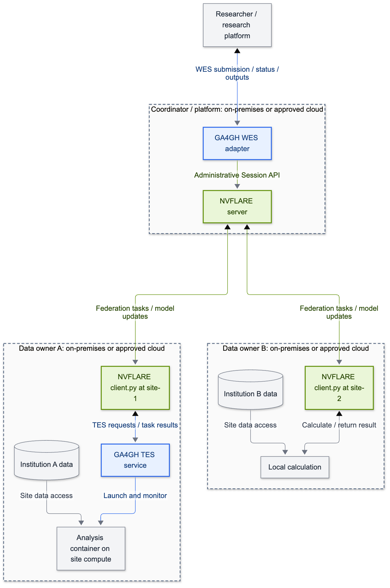

# Optional inbound WES adapter

This is the separate platform-to-federation integration. The main [recipe-driven example](README.md) calls an existing institution WES from `client.py` and needs no inbound adapter.

Research platforms already help scientists find data, submit analyses, and collect results. Federated analysis adds a new requirement: coordinate work across institutions while each institution manages its own data and computing environment. We want those platforms to be able to request a federated analysis through a familiar interface, without having to manage the federation themselves.

This example connects **NVFLARE 2.9.0** to execution APIs from the **Global Alliance for Genomics and Health (GA4GH)**. NVFLARE continues to coordinate the participating sites and combine their results. A small adapter lets a research platform submit, monitor, and cancel the complete analysis through WES. An optional TES example lets an individual site use its existing execution service for its part of the calculation.

A motivating use case is a genome-wide association study (GWAS): each institution runs an analysis on its own cohort, and a central step combines the approved summary statistics. [FedGX](fedgx-notes.md) is an existing NVFLARE example of that pattern. We start here with small synthetic NumPy arrays so you can test the integration before setting up genomics tools or institutional infrastructure.

## How the pieces fit together

| Component | Responsibility in this example |
|---|---|
| [WES — Workflow Execution Service](https://ga4gh.github.io/workflow-execution-service-schemas/docs/) | Gives the submitting platform one API for the complete federated analysis |
| NVFLARE | Runs the federation, coordinates client tasks, and aggregates results |
| [TES — Task Execution Service](https://ga4gh.github.io/task-execution-schemas/docs/) (optional) | Runs one site's local calculation using that institution's execution service |



[View SVG](diagrams/adapter-overview.svg) · [Editable source](diagrams/adapter-overview.mmd)

**Color key:** blue = GA4GH WES/TES integration; green = NVFLARE APIs and federation;
gray = research platform, data, and ordinary analysis code. Dashed boxes show **operational ownership**, not
physical machines. This diagram shows the optional mixed TES/local setup; the quickstart below runs both
sites locally. The data stores illustrate the intended deployment; the pilot calculates on synthetic arrays.

### Where WES and TES run

**GA4GH supplies API standards, not a hosted execution service.** WES and TES are services that an organization
deploys or obtains from an approved provider. The standards support different platforms: [WES](https://ga4gh.github.io/workflow-execution-service-schemas/docs/)
provides workflow submission, and [TES](https://ga4gh.github.io/task-execution-schemas/docs/) can expose execution
on an HPC scheduler or cloud compute backend.

| Component | Placement in this pilot's architecture | Who operates or approves it |
|---|---|---|
| WES adapter and its state | Beside the federation coordinator, with access to the NVFLARE administrative API | A coordinating institution, consortium platform, or trusted platform provider |
| NVFLARE server | Coordinator environment; it need not share a machine with WES | The federation operator |
| NVFLARE client | Each data owner's environment | That institution |
| Optional TES service, workers, and staging | Each participating site's execution environment | That institution or its approved compute provider |
| Site data | Storage accessible to the site's authorized calculation | The data owner |

An institution-controlled cloud account can sit inside the same logical boundary as on-premises compute.
A third party can host a service when the institution approves its data access, credentials, execution, and
operational responsibilities. Being physically in a cloud does not determine who controls access.

For this design, a WES request coordinates the whole federation; it does not directly submit tasks to every
institution's TES service. Each site's `client.py` makes its own TES calls. Site datasets are intended to remain
within that site's approved environment, while NVFLARE carries federation tasks and model updates or other
study-defined results. WES also exposes selected final outputs. The diagrams describe intended placement and
data flow; institutional authorization and output-release controls still need to be established for sensitive data.

The current TES spike uses a shared `file://` staging path. A separately hosted TES deployment needs that
same path to be accessible, or an institution-specific staging implementation. The H100 validation ran all
roles on one host; it tested execution interoperability, not separation between institutions.

The WES adapter uses NVFLARE's administrative `Session` API. TES is called from an existing Client API script; its analysis container does not need NVFLARE credentials or a connection to the federation.

For the implementation details, see the [integration points and code walkthrough](adapter-integration-points.md).
It traces the API calls, persistent state, site execution, cancellation, and result validation to their source files.

**The workflow format in this pilot is NVFLARE-specific:** WES accepts a ZIP containing an exported NVFLARE job. This demonstrates a standard submission interface; it does not translate CWL or WDL workflows into federated jobs.

## Try it locally

The quickstart runs two clients on your machine and submits a three-round synthetic analysis through WES. Each round adds one to a small array. You need Python 3.10 or newer, a POSIX shell, `curl`, and `openssl`. No GPU, TES service, or genomic dataset is needed.

### 1. Install the example

Start in this example's directory inside your NVFlare repository copy:

```bash
cd /path/to/NVFlare/integration/ga4gh
python3 -m venv .venv
source .venv/bin/activate
python -m pip install -e . -r requirements-adapter.txt
python -c 'import nvflare; print(nvflare.__version__)'
```

The dependencies install the released **`nvflare==2.9.0`** package alongside the adapter. The version check should print `2.9.0`. Keep this directory as your working directory for the commands below; running Python from the repository root can import its development sources instead of the installed release. No source build or particular Git commit is needed.

For an existing federation, install NVFLARE 2.9.0 on the server and clients too. Install this integration at clients that run its sample analysis.

### 2. Start two clients and export a job

Use a new temporary directory for this demonstration:

```bash
export DEMO_DIR="$(mktemp -d /tmp/ga4gh-demo.XXXXXX)"
export NVFLARE_POC_WORKSPACE="$DEMO_DIR/poc"
nvflare poc prepare -n 2
nvflare poc start
python examples/job.py --job-dir "$DEMO_DIR/jobs"
python -m zipfile -c "$DEMO_DIR/job.zip" "$DEMO_DIR/jobs/ga4gh-numpy"
```

Wait for the POC server and both clients to start before continuing. The sample uses local calculation at both sites by default. The exported job contains the analysis configuration and client script; the POC supplies the federation and its provisioned identities.

### 3. Start the WES adapter

The adapter needs two credentials: a bearer token for callers of WES, and the provisioned admin startup kit it uses to submit jobs to NVFLARE.

```bash
export WES_API_TOKEN="$(openssl rand -hex 32)"
export WES_STATE_DIR="$DEMO_DIR/wes-state"
export WES_PUBLIC_URL=http://127.0.0.1:8000/ga4gh/wes/v1
export NVFLARE_ADMIN_USER=admin@nvidia.com
export NVFLARE_STARTUP_KIT="$NVFLARE_POC_WORKSPACE/example_project/prod_00/admin@nvidia.com"
export NVFLARE_STUDY=default
uvicorn ga4gh_bridge.app:create_app --factory --host 127.0.0.1 --port 8000 --workers 1 \
  > "$DEMO_DIR/wes.log" 2>&1 &
WES_PID=$!

curl --fail-with-body --retry 10 --retry-connrefused --retry-delay 1 \
  "$WES_PUBLIC_URL/service-info" -H "Authorization: Bearer $WES_API_TOKEN"
```

Keep using this shell so the following commands share the same token. The service information should advertise WES `1.1.0`, workflow type `NVFLARE` version `1.0`, and engine version `2.9.0`.

### 4. Submit and follow the analysis

```bash
curl --fail-with-body "$WES_PUBLIC_URL/runs" \
  -H "Authorization: Bearer $WES_API_TOKEN" \
  -F workflow_type=NVFLARE -F workflow_type_version=1.0 \
  -F workflow_url=job.zip -F 'workflow_params={}' \
  -F "workflow_attachment=@$DEMO_DIR/job.zip;filename=job.zip"
```

Copy the returned `run_id` into the next command:

```bash
export RUN_ID="replace-with-returned-run-id"
curl --fail-with-body "$WES_PUBLIC_URL/runs/$RUN_ID/status" \
  -H "Authorization: Bearer $WES_API_TOKEN"
```

Repeat the status request until it reports `COMPLETE`. If it reports an error, inspect the run response and the log at `$DEMO_DIR/wes.log`:

```bash
curl --fail-with-body "$WES_PUBLIC_URL/runs/$RUN_ID" \
  -H "Authorization: Bearer $WES_API_TOKEN" | python -m json.tool
```

The run response includes diagnostics and output URLs. For this sample, download the first output and inspect the final array:

```bash
curl --fail-with-body "$WES_PUBLIC_URL/runs/$RUN_ID/outputs/0" \
  -H "Authorization: Bearer $WES_API_TOKEN" -o "$DEMO_DIR/server.npy"
python -c 'import os, numpy as np; print(np.load(os.environ["DEMO_DIR"] + "/server.npy", allow_pickle=False))'
```

Expected result after three rounds:

```text
[[ 4.  5.  6.]
 [ 7.  8.  9.]
 [10. 11. 12.]]
```

To check that result automatically and create a visual report:

```bash
python -m pip install -r requirements-validation.txt
python -m ga4gh_bridge.report --model "$DEMO_DIR/server.npy" --rounds 3 --out "$DEMO_DIR/report"
```

Open `$DEMO_DIR/report/index.html` in your browser. It compares the downloaded array with the expected values and
reports numerical errors. The command exits with an error if the result is missing, malformed, or incorrect.
The report is self-contained; PNG/SVG figures and JSON checks are saved alongside it. This validator is specific
to the synthetic NumPy example. A GWAS job needs its own scientific acceptance criteria.

To cancel a run while it is active, use `POST /runs/{run_id}/cancel`. Cancellation is asynchronous; check its status afterward. A run that finishes before cancellation takes effect can still report `COMPLETE`.

When finished, stop the adapter and the demonstration federation:

```bash
kill "$WES_PID"
nvflare poc stop
```

Keep `$DEMO_DIR` if you want to inspect logs and results. In a persistent deployment, keep the WES state directory across adapter restarts.

## Use your own analysis or execution service

**Another NVFLARE job:** Export the job, ZIP its top-level directory, and submit it as above. Configure `WES_OUTPUT_PATHS` before starting the adapter to select the result files callers may download. The default is `workspace/models/server.npy`; a GWAS job needs its own output list. The [WES reference](wes-reference.md) covers the supported inputs, endpoints, limits, status mapping, and retry behavior. Remote workflow URLs and parameter templating are outside this pilot.

**TES at one site:** Follow the [TES example](tes-example.md) to configure a site-owned endpoint, credentials, container image, and shared staging area. The NVFLARE client stays running normally. Local and TES modes use the same synthetic analysis contract, so one site can use TES while another computes locally. This is optional and does not launch NVFLARE workers through TES.

**Federated GWAS:** The [FedGX notes](fedgx-notes.md) identify its existing Client API integration, job export path, summary-statistics contract, and compatibility checks. Its scientific pipeline needs a separate validation using agreed synthetic inputs and numerical acceptance criteria.

## Authentication and the governance roadmap

This pilot uses synthetic data and existing NVFLARE provisioning. All WES endpoints and output downloads require the pilot bearer token. Its holders share one service account and the same run visibility. Use HTTPS and an appropriately scoped account when moving beyond a local demonstration; keep credentials at the institution operating each service.

GA4GH Passports/Visas can later carry verifiable researcher attributes and access permissions, while DUO can describe dataset-use permissions. Institutional services must evaluate and enforce those permissions, preserve researcher attribution through service-account submissions, and record decisions against the resulting jobs. The [governance roadmap](governance-roadmap.md) explains this next phase. It is architecture guidance only: neither governance integration nor WES/TES adoption is required to join the synthetic-data pilot.

## Validation and further reading

From this example directory:

```bash
python -m pip install -r requirements-validation.txt
python -m pytest -q tests
python tests/poc_smoke.py --workdir /tmp/ga4gh-validation-new
```

Use a new work directory for the smoke test and stop any other POC using the same ports first. The test starts a
real two-client NVFLARE 2.9.0 federation and a live HTTP WES server, compares direct and WES-submitted
`hello-numpy` results, and runs a mixed TES/local analysis. It checks every site's update in every round, restarts
WES during a run, verifies retry-safe submission, and exercises cancellation. Open
`/tmp/ga4gh-validation-new/report/index.html` afterward for arrays, numerical checks, and observed timings.
Logs and downloaded models remain in the work directory; the test stops its federation.

By default, TES is a local protocol fixture that executes the trusted synthetic calculation without containers.
For **real TES container execution**, follow the [Docker + Funnel validation guide](validation/README.md).
It runs the same checks with an actual TES service, verifies cancellation of a running container task, and checks
that no analysis containers remain. An existing site TES endpoint can also be supplied with `--tes-endpoint`.

The [saved H100 validation report](results/h100-20261022/index.html) shows a successful run with NVFLARE 2.9.0
and Funnel executing real containers. All three result paths matched exactly:


- [Validation results and remaining checks](validation.md)
- [Integration points and code walkthrough](adapter-integration-points.md)
- [WES API and operational reference](wes-reference.md)
- [Optional TES execution](tes-example.md)
- [FedGX integration notes](fedgx-notes.md)
- [Passports and DUO roadmap](governance-roadmap.md)
