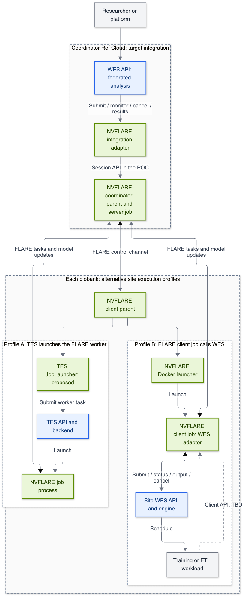
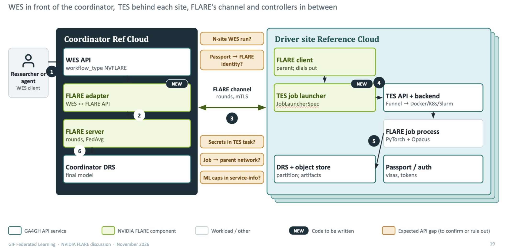
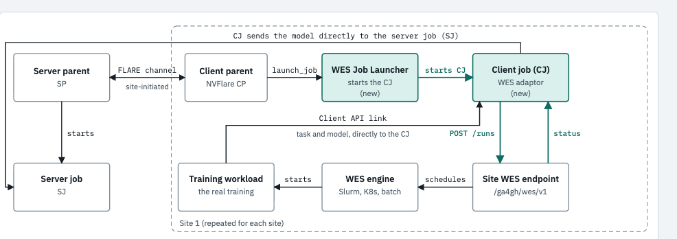
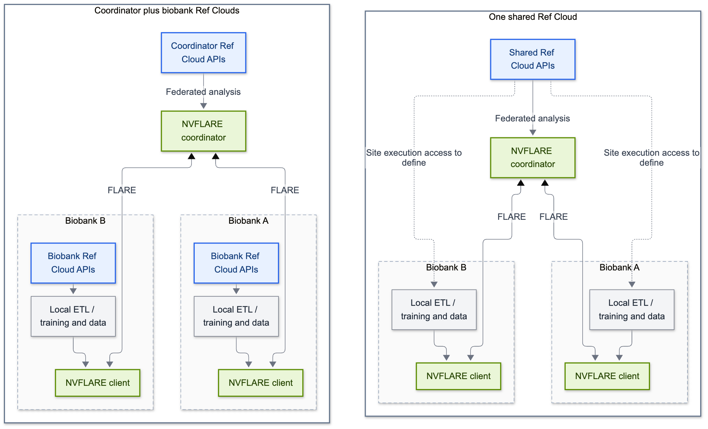

# Integration design: Reference Cloud and NVFLARE

**Design record: November 4, 2026.** This captures the GA4GH discussion, the supplied schematics, and the subsequent email proposals. Ref Cloud launching a federated NVFLARE analysis is the primary target; ETL is a parallel workstream. Site execution through WES, TES, or both remains a design choice. Ref Cloud integration, the proposed launchers, DRS, TRS, and delegated identity are not implemented by this POC.

## Shared goal and existing evidence

A researcher should be able to request a federated analysis through Ref Cloud, while NVFLARE coordinates participating institutions, training rounds, and aggregation. Institutions should also be able to reuse GA4GH execution services for data preparation and local training. Ref Cloud would provide a reusable starting point for GIF and other projects.

The current example contains two independently demonstrated integration paths:

- **Inbound WES:** a WES API accepts an exported NVFLARE job and uses the administrative Session API to submit, monitor, cancel, and download results. It advertises the custom workflow type `NVFLARE`, version `1.0`. See the [adapter guide](inbound-wes.md).
- **Client-side WES/TES:** an already-running NVFLARE job calls an external analysis between `flare.receive()` and `flare.send()`. See the [code walkthrough](integration-points.md) and [TES example](tes-example.md).

The [validation record](validation.md) covers released NVFLARE 2.9.0, synthetic calculations, and real Toil/Funnel execution on one host. It does not establish a Ref Cloud deployment, a TES `JobLauncherSpec` implementation, a Docker-packaged WES adaptor job, or cross-institutional authorization. The POC's NumPy results are not scientific evidence for GWAS, variant classification, or imaging.

## Discussion record

These are attributed paraphrases of the conversation and email excerpts supplied for this design. They express proposals and intent, not resource commitments or verified delivery. Contact details and email signatures are omitted.

| Contributor | November 4 contribution | Design implication |
|---|---|---|
| Brian D OConnor | Ref Cloud plus FLARE could complete the GIF demonstration and give other projects a starting point; the hackathon could accelerate linking WES/TES to FLARE. | Prioritize a reusable Ref Cloud integration and deployment example. |
| Jeremy Adams | Suggested making FLARE an allowable WES/TES backend and providing suitable deployment tooling. Shared the Ref Cloud monorepo, identified its production instance, and offered additional instances to simulate a federation. | Inspect the actual backend extension points and test with separate demonstration instances. No completed NVFLARE backend was established by the discussion. |
| Venkat Malladi | Described the hackathon as connecting NVFLARE to Ref Cloud. Later suggested starting with WES → NVFLARE per biobank and writing weights to a central DRS or another shared server. | Define the scope of each WES run and who coordinates and aggregates across biobanks; shared storage alone does not define the federation protocol. |
| Chester Chen | Proposed a Docker launcher starting a FLARE client job containing a WES client. That job communicates with its client parent through FLARE, calls the site's WES endpoint for training, retrieves the updated model, and returns it to the FLARE server job. | Evaluate a WES-adaptor client job as an alternative to TES launching the FLARE job process itself. |
| Brian, replying to Chester | Asked whether the process launched from the client parent should use WES, TES, or both, depending on full-workflow versus individual-job needs. | Keep execution granularity open; do not present either launcher as the agreed implementation. |
| bbusby | Indicated work had started after the Ref Cloud links and additional-instance offer were shared. | Record activity without inferring a completed deployment or assigning ownership. |

The parallel team focus raised in the discussion is **ETL in Ref Cloud + NVFLARE**, with either one central Ref Cloud or one per biobank. Team owners and deliverable assignments remain open.

## Primary target and execution granularity

[SVG](diagrams/refcloud-target.svg) · [Editable source](diagrams/refcloud-target.mmd)

This is a synthesis of the proposals, not an implemented deployment or a replacement for the source schematics below. **Blue = GA4GH; green = NVFLARE; gray = analysis or infrastructure.** The two site branches are alternatives, not two mandatory steps. Storage and identity are described separately below.

At the coordinator, WES exposes the lifecycle of a federated analysis. A backend integration invokes NVFLARE, which owns federation communication and aggregation. Our inbound adapter's `submit_job()`, `get_job_meta()`, `abort_job()`, and `download_job_result()` calls are a candidate foundation. Integrating that logic into Ref Cloud, choosing how it is hosted, and provisioning the federation remain work to do.

At a site, distinguish these execution profiles:

| Profile | What gets launched | What participates in FLARE communication | POC relationship |
|---|---|---|---|
| **A: TES launches the FLARE job** | A site-owned TES launcher implementing `JobLauncherSpec` submits a task whose payload is the FLARE job process. | The launched FLARE worker must reach its parent and participate in federation job communication. | Not implemented. Our `TesRunner` launches an analysis script, not a FLARE worker. |
| **B: FLARE client job calls WES** | A Docker launcher starts a FLARE client job containing the WES adaptor; the adaptor submits local training as a workflow. | The adaptor job remains connected to FLARE. The sketch also shows a Client API link from training to the adaptor; the exact return transport remains open. | Closest to the existing Client API WES call pattern. The proposed Docker packaging, launcher configuration, and network arrangement are not validated. |
| **C: analysis or ETL through Client API** | An already-running client script submits analysis to WES or TES and validates the output. | The existing client job receives and sends the federated task/result. | Implemented for synthetic array calculations. A real ETL contract is still required. |

Profile B can use a WES engine that schedules individual tasks through TES. That composition differs from profile A, where TES launches the FLARE runtime. Calling a component a “WES Job Launcher” does not resolve which process the launcher starts; the payload and communication boundary must be explicit.

### GA4GH team schematic: coordinator WES and site TES launchers

Source: GA4GH/NVIDIA discussion slide supplied on November 4, 2026; original colors and labels retained. It shows coordinator WES with `workflow_type: NVFLARE`, a FLARE adapter and server, and a site TES `JobLauncherSpec` starting a FLARE job process. DRS, Passport/auth, and PyTorch/Opacus appear in the target architecture. They are not evidence of implemented support in this example.

Its orange callouts remain open questions: the meaning of one WES run across N sites, Passport-to-FLARE identity mapping, secrets in TES tasks, job-to-parent networking, and ML capabilities in service information. Profile A requires resolving these and defining a job handle that can poll, wait, and terminate remote work.

### Chester's schematic: a FLARE client job acting as WES client

Source: Chester Chen's November 4 email proposal and attached schematic, supplied for this design; original colors and labels retained. The diagram separates the server parent, server job, client parent, and client job. The client parent launches the adaptor job; model updates return from that job to the server job. The WES engine schedules the training workload. The email suggests implementing the launcher using Docker with a WES client inside the container.

The sketch also labels a **Client API link** carrying task/model information between the training workload and the client job. The email describes receiving an updated model from the WES endpoint. These leave a transport decision to resolve: artifact retrieval through WES, a live Client API connection, or a defined combination. Our POC uses artifact retrieval; a live link would add training-to-adaptor reachability, API configuration, and lifecycle requirements. Neither the parent cellnet connection nor the model-update channel should be conflated with this link.

In this interpretation the WES adaptor spans FLARE communication and site workflow execution. It must preserve round/task context, retrieve and validate the resulting model, and propagate cancellation across both lifecycles. Its job process must also maintain the required connection to the FLARE parent. The existing `WesRunner` and Client API script demonstrate part of that behavior; they are not a completed implementation of this deployment design.

### Venkat's per-biobank WES proposal

The suggestion to start WES → NVFLARE at each biobank is recorded as another entry-point option. “NVFLARE” could mean a site participant joining a shared federation, or a complete analysis within one biobank; the excerpt does not settle that scope. Before implementing it, specify who owns global rounds and aggregation, which process joins which federation, and how independent WES runs map to one analysis.

A central DRS or another shared artifact service could expose versioned weight objects. Upload/registration, access permissions, checksums, round provenance, and output release need explicit contracts. Publishing weights does not by itself coordinate rounds, define aggregation, or replace FLARE's communication channel. Do not assume an artifact-upload operation merely from a DRS reference.

## Parallel ETL workstream and deployment options

| Workstream | Intended outcome |
|---|---|
| **Ref Cloud execution integration** | Submit and manage a federated NVFLARE analysis, select a site execution profile, and provide repeatable deployment and cleanup tooling. |
| **ETL in Ref Cloud + NVFLARE** | Discover and execute data-preparation workflows, validate their outputs, and supply versioned site-local inputs to the federation. |

ETL may happen before a job or during a site task; its cadence and output contract must be agreed for the workload. Record dataset/feature schema, workflow version, output location, and validation results. Prepared data stays within the institution's approved environment unless explicitly released. “GA4GH ETL” describes this use case; WES/TES also support training and other computation.

[SVG](diagrams/refcloud-topologies.svg) · [Editable source](diagrams/refcloud-topologies.mmd)

- **One shared Ref Cloud:** a shared API/control environment serves multiple biobanks; placement and authorized access to execution workers and data must still be defined. Central control does not imply central data storage or unrestricted access to biobank networks.
- **Ref Cloud per biobank:** each institution controls its execution/data services. A coordinator environment manages the federated analysis. This is closest to the coordinator-plus-driver-site arrangement in the GA4GH slide.

Jeremy's offer of more instances provides a way to simulate these topologies. Instances on one host or cloud account do not establish real institutional isolation. The production URL is a reference, not the deployment target for this work.

## Roles of the GA4GH interfaces

| Interface | Proposed responsibility | Current example |
|---|---|---|
| **WES** | Lifecycle of a complete federated analysis at the coordinator, or a site workflow in profile B/C; specify the scope at each endpoint. | Inbound adapter and site-side consumer implemented separately. |
| **TES** | Execute a FLARE worker in profile A, or analysis/ETL tasks directly or behind WES. | Direct synthetic analysis only; no TES FLARE job launcher. |
| **TRS** | Discover tools/workflows and retrieve a chosen version's descriptors and associated metadata before execution. | Not integrated; the POC submits local CWL attachments. |
| **DRS / artifact storage** | Resolve site datasets and approved model artifacts; agree how new artifacts are uploaded and registered. | No DRS support; shared-file and restricted HTTP output retrieval only. |
| **Passports / authorization** | Verify identity and access evidence, scope delegation, and enforce institutional decisions. | Site credentials and existing NVFLARE identities; no verified end-user delegation. |
| **DUO** | Describe data-use permissions for institutional policy evaluation. | Architecture guidance only. |

[TRS](https://www.ga4gh.org/product/tool-registry-service-trs/) supports discovery and retrieval of tools/workflows; it does not execute them or store training datasets. A shared registry can serve either deployment topology. A future resolver must turn a chosen tool/version into inputs accepted by the execution service; automatic `trs://` support or TRS support for the custom NVFLARE ZIP format is not assumed. See the [TRS data model](https://ga4gh.github.io/tool-registry-service-schemas/DataModel/).

The [governance roadmap](governance-roadmap.md) remains applicable to both coordinator and site entry points. Authorization belongs in institution-controlled services. A client script or self-asserted correlation tag is not an authorization boundary.

## Hackathon decisions and acceptance evidence

Before choosing a runtime implementation, resolve:

1. **WES run scope:** one complete federation, a site participant, or a local workflow; define correlation across job, site, round, WES runs, and TES tasks.
2. **Ref Cloud integration and provisioning:** backend extension point, adapter hosting, persistent versus per-run federation components, and the selected site profile. Verify launcher APIs and behavior against the supported NVFLARE release.
3. **Runtime access:** worker-to-parent networking, any training-to-adaptor Client API connection, workspace/data staging, service credentials and secrets, delegated authorization, and output-release policy. Container boundaries do not establish these contracts.
4. **Artifacts and discovery:** TRS version resolution, ETL input/output contracts, model serialization, upload/registration, and DRS or other storage access.
5. **Lifecycle:** queue deadlines, ambiguous submissions, restart reconciliation, cross-layer cancellation, result readiness, and cleanup when a parent or backend fails.

Validate the chosen profile with two sites: submit through the coordinator, verify the intended payload is launched at each site, compare results to direct execution, and test abort/restart without orphaned work. For profile A, show that TES launched a FLARE worker and that it communicates with its parent. For profile B, show the Docker adaptor job and the separate WES workload, including the chosen training-to-adaptor transport and model return to the server job. ETL acceptance needs its own fixtures and output criteria. Do not reuse profile C's successful tests as evidence for A or B.

## References and workload candidates

- [Ref Cloud monorepo branch shared by Jeremy](https://github.com/ga4gh/ga4gh-reference-cloud/tree/ja-iss-30-monorepo-structure): its README describes the core API, researcher UI, admin CLI, identity services, and local/Helm deployment. This is a development reference, not a commitment to a particular backend extension API.
- [Ref Cloud instance](https://refcloud.ga4gh.org/): identified by Jeremy as the production instance; availability and NVFLARE capability were not independently verified for this design.
- [CogniWarriors](https://github.com/collaborativebioinformatics/CogniWarriors): related imaging/phenotype work. Its README and job builder describe NVFLARE 2.9 FedAvg, global feature scaling, and simulator/export/deployment paths. It is a workload and packaging reference, not a validated GA4GH integration. No scientific results were reproduced here.
- [FedGX notes](fedgx-notes.md): a separate GWAS candidate requiring its own workflow, aggregation contract, and acceptance criteria.
- The supplied GIF proposal describes iterative variant-pathogenicity classification with PyTorch/Opacus. That scientific demonstration differs from both GWAS and imaging, and remains unimplemented in this integration.

No new launcher, Ref Cloud deployment, data registry, identity integration, or scientific validation is delivered by this design record. Runnable POC instructions and their evidence remain in the linked guides.
