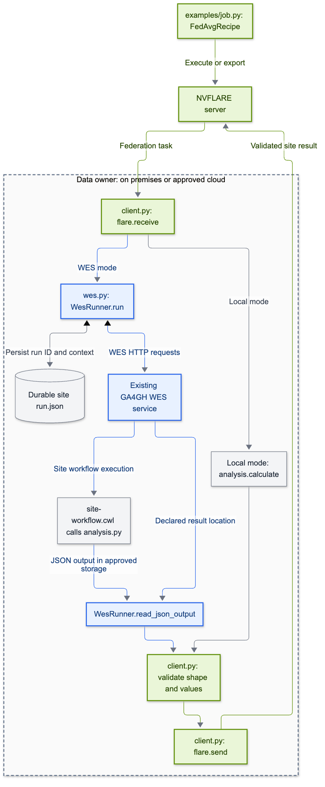

# Integration points: a recipe calls site WES

The primary prototype uses **`FedAvgRecipe` directly** with `framework=FrameworkType.NUMPY`. NVFLARE runs the federation; each participating site can call its existing GA4GH WES engine from `client.py`.



[SVG](diagrams/integration-points.svg) · [Editable source](diagrams/integration-points.mmd)

Blue denotes GA4GH interfaces; green denotes NVFLARE. Each data owner operates or approves its execution environment, including any cloud infrastructure. The WES helper runs in the NVFLARE client process; the actual WES service and its workers may run elsewhere within that institution's approved environment.

## 1. Build and execute a normal recipe

[`examples/job.py`](examples/job.py) constructs `FedAvgRecipe` with a NumPy initial model and `train_script` pointing to `client.py`. `--workspace` runs it with two clients in `SimEnv`; `--job-dir` exports it for an existing federation. No custom controller or core NVFLARE changes are required.

## 2. Call WES between receive and send

[`examples/client.py`](examples/client.py) implements:

```python
model = flare.receive()
# Convert the received array to the sample workflow's input contract.
outputs = runner.run(parameters, context, attachments=attachments, check_cancel=check_cancel)
result = runner.read_json_output(outputs.get("result"))
# Check result shape and finite values; convert to FLModel.
flare.send(result_model)
```

The full script supplies the concrete arguments and constructs `result_model`. The `context` binds the external run to NVFLARE job, site, task, and round. Local mode calls `analysis.calculate`; WES mode uploads the same `analysis.py` and invokes it through [`site-workflow.cwl`](examples/site-workflow.cwl). Both return JSON with a `weights` array. The optional TES mode remains available.

## 3. Consume the institution's WES API

[`ga4gh_bridge/wes.py`](ga4gh_bridge/wes.py) contains `WesRunner`:

| Operation | Existing WES endpoint |
|---|---|
| Submit CWL and inputs | `POST /runs` with multipart workflow attachments and parameters |
| Poll lifecycle | `GET /runs/{run_id}/status` |
| Read output references | `GET /runs/{run_id}` |
| Request cancellation | `POST /runs/{run_id}/cancel` |

This module **calls** a WES service; it does not implement a server. Endpoint, credential, workflow, and output access settings come from `SITE_WES_*` environment variables controlled by the site. The current output reader supports same-origin HTTP JSON and approved shared `file://` storage.

## 4. Record external work and handle interruption

`WesRunner` writes `run.json` before submission and records the returned WES run ID afterward. A lock prevents concurrent submission of the same operation. Its fingerprint includes parameters, workflow bytes, and analysis attachment bytes. A repeated operation reuses its run; conflicting inputs fail.

A lost POST response leaves `SUBMISSION_UNKNOWN`, with no blind retry. The operator can find the run and use `adopt()` to check its correlation tags. Deadlines and graceful Client API aborts cancel remote work and wait for a terminal state. An unconfirmed cancellation leaves `CANCEL_UNCONFIRMED`. The CLI supports operator cleanup after a hard client kill; an independent site supervisor is a future hardening step.

## 5. Return validated results to NVFLARE

WES returns a declared `result` File. The helper retrieves and bounds the JSON output; `client.py` checks shape and finite values before constructing and sending `FLModel`. NVFLARE then aggregates the site results normally. The report verifies the final array and per-round agreement; it does not establish GWAS correctness.

## Separate optional inbound integration

The earlier **research platform → WES adapter → Session API → federation** implementation is retained in `app.py`, `service.py`, `store.py`, and `backend.py`. It is not started by this recipe and is not required for client-side WES. See the [inbound adapter guide](inbound-wes.md) and [adapter code walkthrough](adapter-integration-points.md).

Passports/Visas and DUO remain [future architecture guidance](governance-roadmap.md). Institution-controlled execution/data services must enforce policy independently of submitted client scripts.
