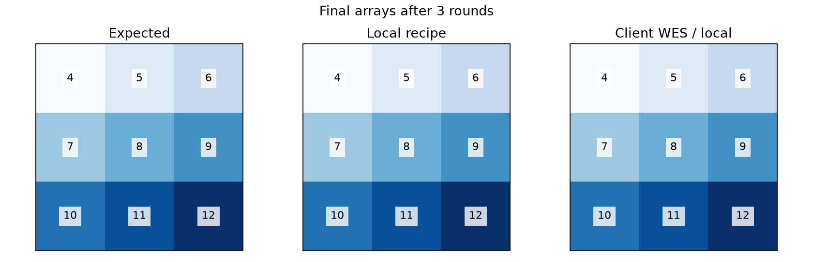
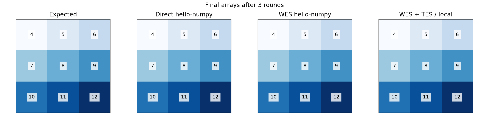
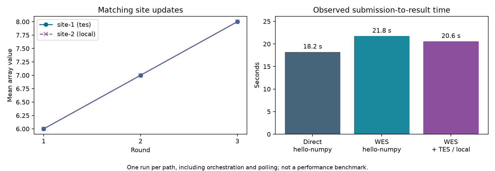

# Pilot validation records

The primary example uses a standard `FedAvgRecipe` calling site WES from `client.py`. Its reproduction guide is [Client API WES validation](validation/client-wes.md). The two records below distinguish this path from the optional inbound adapter/TES implementation.

## Recipe and client-side WES: 2026-10-26

**Passed on the H100 host `r1u14`:** published **NVFLARE 2.9.0**, the unified **`FedAvgRecipe(framework=FrameworkType.NUMPY)`**, and a real **Toil 9.6.0 WES engine** executing the supplied CWL workflow. Two simulator clients completed three rounds, first both locally, then with site-1 using WES and site-2 calculating locally. The calculation used CPU only; no GPU was allocated.

Open the saved [visual report](results/h100-20261026/index.html), [JSON checks](results/h100-20261026/validation.json), and [run evidence](results/h100-20261026/summary.json).

| Check | Result |
|---|---|
| Full integration test suite | 108 passed; one upstream Starlette test-client deprecation warning |
| End-to-end result checks | All 33 passed |
| Local and mixed WES/local final models | Identical expected arrays; maximum absolute error and RMSE were zero |
| All three rounds at both sites | Expected inputs and outputs; WES and local calculations matched |
| WES run attribution | Exactly one completed run per round, linked to job, site, task, and round |
| Reopening the client helper | Reused the recorded WES run without another submission |
| Active CWL cancellation probe | Actual in-process Client API abort caused WES cancellation and confirmed `CANCELED` |
| Scoped repository style check | `./runtest.sh -s --skip-install integration/ga4gh` passed black, isort, and flake8 |
| Scoped license-header check | `python ci/check_license_header.py integration/ga4gh` passed |
| End-to-end runner exit code | 0 |

Toil advertises WES **1.0.0** and CWL **v1.2**. The helper uses common WES run endpoints; its submission is also checked against the official WES 1.1.0 request schema in unit tests. This run does not establish full WES 1.1.0 conformance of Toil.

The cancellation probe is separate from the simulator federation: a real CWL task writes a start marker, then sleeps until canceled through the Client API abort callback. This verifies active workflow cleanup, but not administrative cancellation of a distributed federation. Hard process termination still requires institutional reconciliation of retained run records.

The runtime used Python 3.12.15, HTTPX 0.28.1, and NumPy 2.5.4 inside a disposable four-CPU / 8 GB container. Toil ran CWL with `--no-container` inside that environment. All roles shared one host; institutional authentication, isolation, and storage controls remain site acceptance checks. Local and mixed run durations were approximately 17.2 and 29.2 seconds, respectively, including simulator startup and polling. These observations are not a performance benchmark.

The [summary](results/h100-20261026/summary.json) records installed versions, WES service information, Python/CWL source hashes, site traces, and WES run IDs. Full execution logs and workflow workspaces remain at `/scratch/hroth/Code/nvflare/ga4gh-client-wes-20261026/output/run-03` on the H100 host. Retained artifacts include the [local model](results/h100-20261026/local.npy), [WES/local model](results/h100-20261026/client_wes.npy), [end-to-end log](results/h100-20261026/validation.log), [full test and style log](results/h100-20261026/final-checks.log), and [final scoped checks](results/h100-20261026/final-scoped-checks.log).

This validates the synthetic integration contract. The supplied GWAS implementation and its scientific acceptance criteria remain a separate next step.

## Earlier inbound WES and TES run

**Passed on 2026-10-22:** a real two-client federation using the published **NVFLARE 2.9.0** package,
a live HTTP WES adapter, and **Funnel 0.11.14 executing Docker analysis containers** on the H100 host `r1u14`.
The synthetic NumPy calculation uses CPU only; no GPU was allocated.

Open the saved [visual report](results/h100-20261022/index.html) locally, or inspect the
[JSON checks](results/h100-20261022/validation.json) and [run evidence](results/h100-20261022/summary.json).
All **36 end-to-end result checks** passed. See the [Docker + Funnel guide](validation/README.md) to reproduce the run.

## What was verified

| Check | Result |
|---|---|
| Focused adapter, TES, and report tests in the H100 runtime | 86 passed; one upstream Starlette test-client deprecation warning |
| Official WES 1.1.0 responses and TES task-schema validation | Passed within the focused suite |
| Direct `hello-numpy`, same job through live WES, and WES with site-1 TES / site-2 local | All three produced the expected array; maximum absolute error and RMSE were zero |
| Per-site inputs and outputs for all three rounds | Six traces matched the expected calculation; TES and local results were identical |
| TES task attribution | Exactly one completed TES task for each round of the mixed job |
| Retry-safe administrative submission | Reusing the submission token returned the original NVFLARE job ID |
| WES hard restart during the mixed run | Persisted run retained the same NVFLARE job ID and completed |
| WES authentication | Unauthenticated listing rejected; authenticated submissions and downloads succeeded |
| Early and running federated-job cancellation | Both WES runs reached `CANCELED` |
| Separate TES task canceled after observing `RUNNING` | Reached `CANCELED`; its Docker container was removed |
| Task cleanup | All five recorded TES tasks were terminal; zero remaining labelled analysis containers |
| Wrapper exit code | 0 |
| Scoped style check | `./runtest.sh -s --skip-install integration/ga4gh` passed black, isort, and flake8 |
| Scoped license-header check | `python ci/check_license_header.py integration/ga4gh` passed |

The five TES tasks comprise three completed mixed-job rounds, one round that completed before its federated job
was canceled, and the canceled standalone probe. The running WES cancellation therefore demonstrates convergence
of federation state and remote task cleanup; it does not establish that its short analysis container was
interrupted mid-calculation. Abort detection during active TES polling is also covered by a test using NVFLARE's
actual in-process Client API. The separate sleeping-task probe verifies real TES container cancellation.

Observed submission-to-result times were 18.2 seconds direct, 21.8 seconds through WES, and 20.6 seconds for the
mixed TES/local run. These are single observations including scheduling, polling, and the mixed run's WES restart;
they are **not a performance benchmark**.

## Reproducibility and retained evidence

The runtime used Python 3.12.15, NVFLARE 2.9.0, FastAPI 0.159.1, Starlette 1.9.0, HTTPX 0.28.1, NumPy 2.5.4,
Funnel 0.11.14, and Docker 29.4.0. The validation container had a four-CPU / 8 GB limit. TES analysis containers
used `python:3.12-slim`, one CPU, 1 GB, and `--network none`. The report records the actual image ID and Python
source hashes; setup instructions depend on released versions, not a repository commit.

The validated runtime image was `ga4gh-validation:20261022`, ID
`sha256:d60b57a99fac3617ef3614870e999d5c1504e06f443c8914eaad0c4d8b050c4f`.
The H100 output directory is
`/scratch/hroth/Code/nvflare/ga4gh-validation-20261022-01/output-03`.
It retains full service logs, the Funnel configuration, provisioning, and state. Only synthetic report artifacts
and concise validation logs were copied into this example:

- [End-to-end log](results/h100-20261022/validation.log), [focused test log](results/h100-20261022/unit-tests.log), and [exit code](results/h100-20261022/exit-code.txt).
- [Direct model](results/h100-20261022/direct.npy), [WES model](results/h100-20261022/wes.npy), and [mixed model](results/h100-20261022/mixed.npy).
- Self-contained HTML, PNG/SVG figures, numerical checks, job/task IDs, per-round traces, and runtime provenance in the [report directory](results/h100-20261022).

The same live HTTP runner also passed locally on macOS with Python 3.13.14 and the TES protocol fixture.
The single-model report command returned success for a valid downloaded array and failed with a diagnostic report
for a missing model. Unit tests reject wrong shapes, nonfinite values, incorrect shared results, missing/duplicate
traces, incorrect execution modes, wrong task attribution, unfinished tasks, and unsuccessful recovery/cancellation.
They also cover malformed submissions, output failures, ambiguous HTTP outcomes, queue/execution deadlines, and
cancellation races.

The repository-wide license command ignores its scoped target and encountered an existing unrelated file under
`research/auto-fl-research/results/`. The directly scoped header check above passed; unrelated files were unchanged.

## Remaining external validation

Funnel demonstrates real TES container execution with local file staging. Each institution still needs to validate
its own endpoint authentication, storage permissions, scheduler behavior, cancellation, and operator cleanup.

[FedGX was inspected as a GWAS candidate](fedgx-notes.md), but its scientific pipeline was not executed. A GWAS
comparison needs the supplied exported job, an agreed synthetic dataset, and owner-approved numerical acceptance
criteria. No sensitive data or Passport/DUO enforcement was used in these tests.
